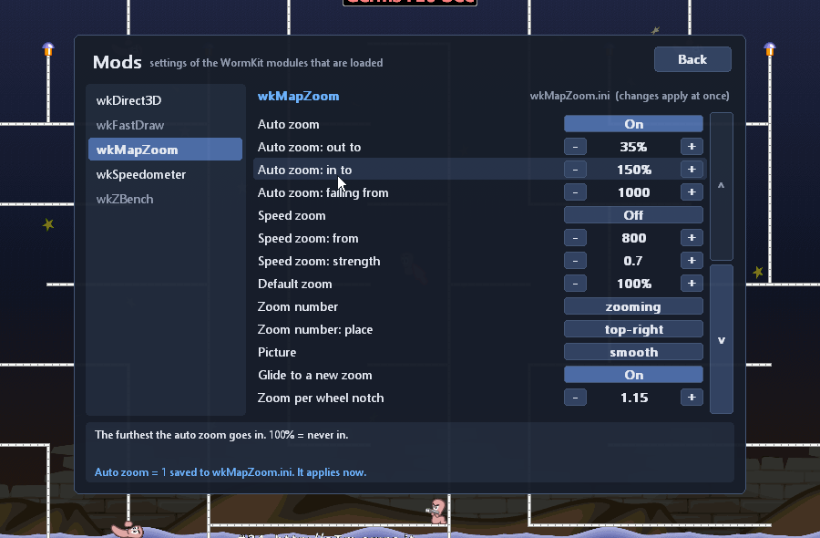
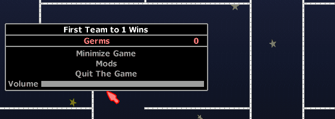
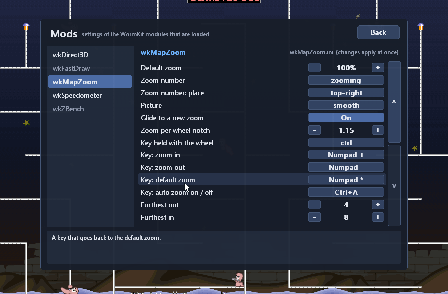

# wkModMenu

One place for the settings of your WormKit modules, **inside the game**. A WormKit module for **Worms Armageddon 3.8.1**.

WA's Esc menu gets one more row: **Mods**. Click it and a panel of its own opens: the wk modules that are loaded on the
left, the chosen module's settings on the right. Click a value to change it. It is saved to that module's ini file at
once, and modules that support it apply the change straight away, without restarting WA.



> **Version 0.1 is a beta.** It has been tested on replays in a window on one PC, alone and with wkDirect3D, wkMapZoom
> and wkSpeedometer and a dozen other modules loaded. If something goes wrong, please
> [open an issue](https://github.com/GermsWorms/wkModMenu/issues) with the log (see Notes).

## What it does

- **One row in WA's Esc menu**, nothing more. The panel is separate: WA's own menu steps aside while it is open.<br>
  
- **Every loaded wk module is listed.** Modules with a settings file are bright, the rest are grey.
- **Settings by kind:** on / off switches, lists of choices, numbers with − and + buttons, and keys.
- **Keys.** For a module that offers its hotkeys as settings (wkMapZoom does), click the key's button and press the new
  key, with Ctrl, Alt or Shift if you like. Delete sets it to none.<br>
  
- **A help line** at the bottom says what the setting under the pointer is for.
- **Esc** closes it, as it closes WA's menu. **Back** returns to WA's menu. The mouse wheel scrolls long lists.

## Which modules can it change?

| | In the panel | A change applies |
|---|---|---|
| Modules that describe their settings to wkModMenu: [wkMapZoom](https://github.com/GermsWorms/wkMapZoom) 5.1, [wkSpeedometer](https://github.com/GermsWorms/wkSpeedometer) 1.1, [wkDirect3D](https://github.com/GermsWorms/wkDirect3D) 0.5 | every setting with a name, the right kind of control, limits and help; hotkeys as keys | at once |
| Any other module with an ini file beside `WA.exe` (wkRealTime, wkTerrainSync, wkTrackMeBetter, ...) | what is in its file: numbers get − and + buttons, on / off words a switch, other text is shown only; the comments above a setting are its help | when that module reads its file again, for most at WA's next start |
| Modules without a settings file | listed in grey | |

**About hotkeys of other modules.** A hotkey that is written into a module's code, and not kept in its ini file,
cannot be seen or changed from outside: nothing in WA or Windows lists it. wkModMenu shows a module's keys only when
the module offers them (see "For module authors") or keeps them in its ini file (then as plain values). To move a key
of such a module, a key remapper such as wkRemapKeys is the way.

The ini file of a module is looked for under the module's own name (`wkMapZoom.dll` → `wkMapZoom.ini`), then without
a `Z` after `wk` (`wkZRealTime.dll` → `wkRealTime.ini`), without digits at the end (`wkTrackMeBetter381.dll` →
`wkTrackMeBetter.ini`), then any ini whose name starts with the module's.

## Install

1. Download `wkModMenu.dll` from [`release/`](release/) and put it in your Worms Armageddon folder, next to `WA.exe`
   (Steam: `...\steamapps\common\Worms Armageddon`; GOG: usually `C:\Program Files (x86)\GOG Galaxy\Games\Worms Armageddon`
   or `C:\GOG Games\Worms Armageddon`). WA must be 3.8.1.
2. In WA: **Options > Advanced >** tick **Load WormKit modules**.
3. In a game: **Esc**, then **Mods**.

Uninstall: delete `wkModMenu.dll`. To switch it off without removing it, put a file `wkModMenu.ini` next to `WA.exe`
with the lines `[wkModMenu]` and `Enabled=0`.

It works with every one of WA's renderers. With [wkDirect3D](https://github.com/GermsWorms/wkDirect3D) loaded the
panel is drawn by the graphics card in full colour; without it, it is drawn into WA's own picture in WA's 256 colours.

## Notes

- **WA 3.8.1 only, Steam or GOG.** The module checks `WA.exe` and does nothing on any other version.
- **Nothing of the game is changed.** While the panel is open the game gets no keys and no mouse, exactly as while WA's
  own Esc menu is open; online games and replays stay in sync, and other players don't need the module. (A replay
  pauses while the menu is open, as WA does it.)
- A change is written to the ini file the moment you click. There is no undo: click again to change it back.
- Settings that only make sense at WA's start (a module's own on / off switch, for example) still need a restart; the
  panel says for each module whether changes apply at once.
- Only modules that are loaded are listed. A module that switched itself off in its ini is still listed if its DLL is
  loaded.
- Log: `%LOCALAPPDATA%\wkModMenu\wkModMenu.log` (send it along with WA's `ERRORLOG.TXT` if WA crashes).

## For module authors

A module can tell wkModMenu what its settings are by exporting two functions (cdecl):

```c
__declspec(dllexport) const char *wkModSettings(void);        /* a text that describes the settings */
__declspec(dllexport) void wkModSettingsChanged(void);        /* optional: a setting was written, read the ini again */
```

The text, one line each:

```
wkModSettings 1
title=wkMapZoom
file=wkMapZoom.ini
section=wkMapZoom
live=1
AutoZoom|Auto zoom|bool||0|The map zooms on its own to fit the space around your worm.
AutoZoomMin|Auto zoom: out to|pct|0.25:1:0.05|0.35|The furthest the auto zoom goes out.
Indicator|Zoom number|choice|zooming,always,off|zooming|When the zoom is shown as a number.
SpeedZoomFrom|Speed zoom: from|int|400:1600:100|800|The speed the speed zoom starts at.
AutoZoomKey|Key: auto zoom on / off|key||Ctrl+A|The key that switches the auto zoom.
```

- `file=` is the ini's name (beside `WA.exe`), `section=` the ini section of the settings that follow, `live=1` says
  that `wkModSettingsChanged` makes changes show at once.
- A setting is `key|label|type|args|default|help`. Types: `bool` (written as 0 / 1), `choice` (args: the choices,
  comma separated), `int` and `num` (args: `min:max:step`), `pct` (a `num` shown in percent), `key`.
- A `key` is kept as text: `A`, `Ctrl+A`, `Alt+F6`, `Shift+PageUp`, `Numpad +`, `Numpad 5`, `Space`, `Key 220` (a
  virtual-key number), or `none`.
- wkModMenu writes with `WritePrivateProfileString` (comments in the file are kept), then calls
  `wkModSettingsChanged` on WA's own thread.

## How it works

WA's `OpenEscMenu` lays out its menu's rows one by one; right after the first, wkModMenu appends "Mods". While WA's
Esc menu is open, WA itself keeps keys and the mouse away from the game, moves its menu pointer and reports clicks.
wkModMenu leaves all of that running and only widens the pointer's limits to the whole screen, has WA's own menu not
drawn, draws its panel and pointer after WA's frame, and takes the clicks. The module list comes from the modules
loaded in WA's process whose names start with `wk`.

Hooks (WA 3.8.1, `WA.exe` and the bytes at each hook point checked): `00533DC0` GameRender, `005356D3` in
`OpenEscMenu` (the extra row), `00540810` the menu's click, `00535000` the menu's drawing, `00528CD0` the game's end,
and a `WH_GETMESSAGE` hook on WA's thread for the mouse wheel and for taking a key.

## Building

Needs a 32-bit MinGW gcc (for example `C:\MinGW\bin\gcc.exe`) and PowerShell:

```powershell
.\build.ps1                 # builds wkModMenu.dll
.\install.ps1               # copies it into the Steam or GOG WA folder (-Game <folder> for another one)
.\install.ps1 -Remove
```

## Credits and licence

- The way into WA's Esc menu (where its rows are laid out, where a click arrives) was found by
  [wkVista](https://github.com/ropahektic/wkVista) (MIT, © 2026 ropahektic) and used by wkMapZoom up to 4.3.
- [MinHook](https://github.com/TsudaKageyu/minhook) (BSD 2-clause), in `third_party/minhook`.
- wkModMenu is MIT licensed: see [LICENSE](LICENSE), and [THIRD_PARTY_NOTICES.md](THIRD_PARTY_NOTICES.md).
